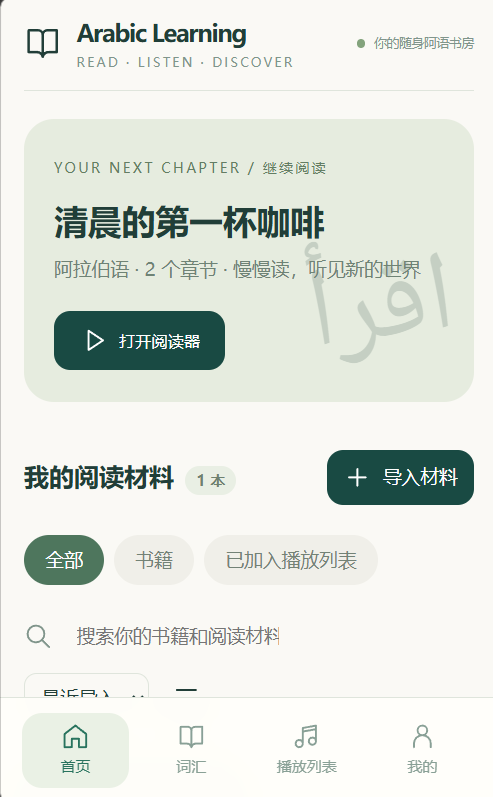
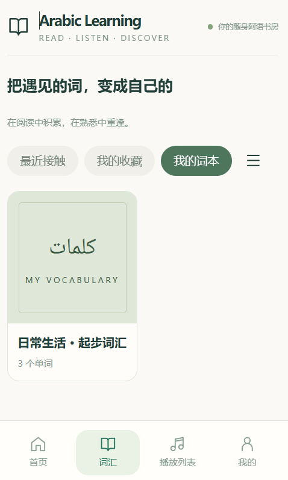
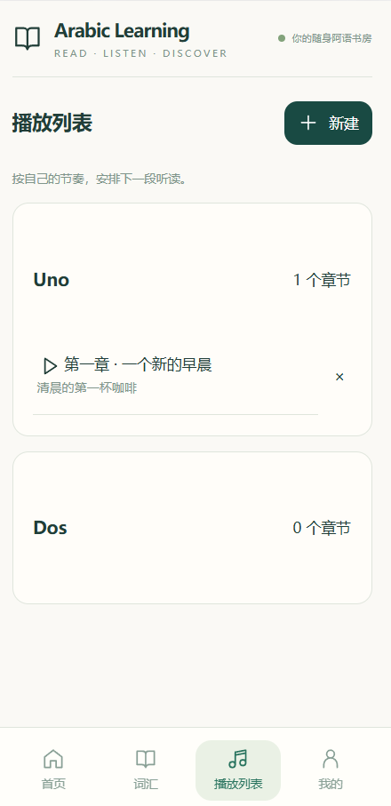
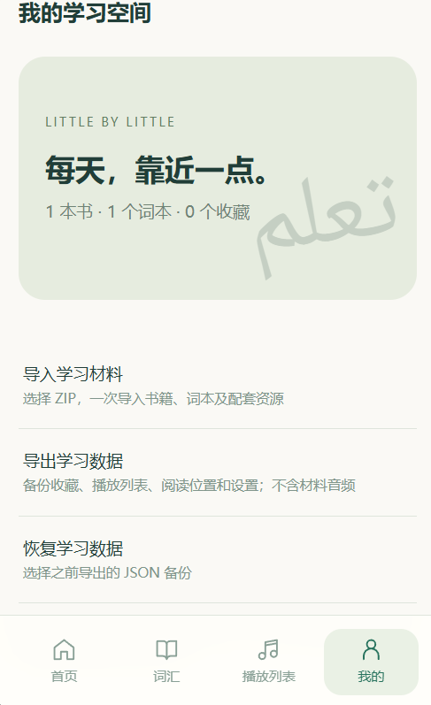
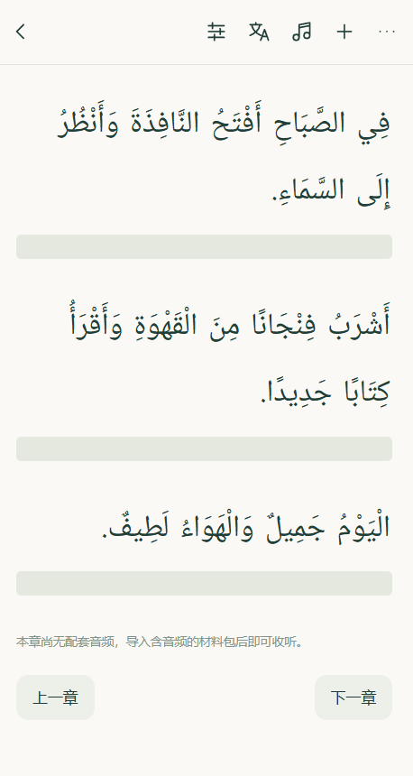
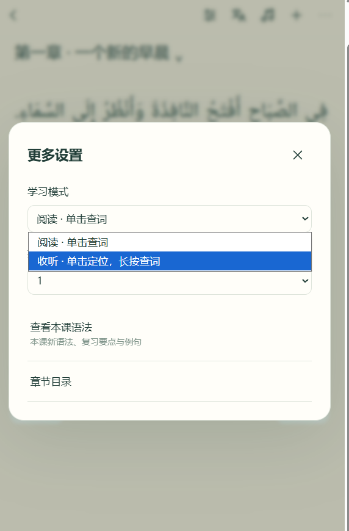
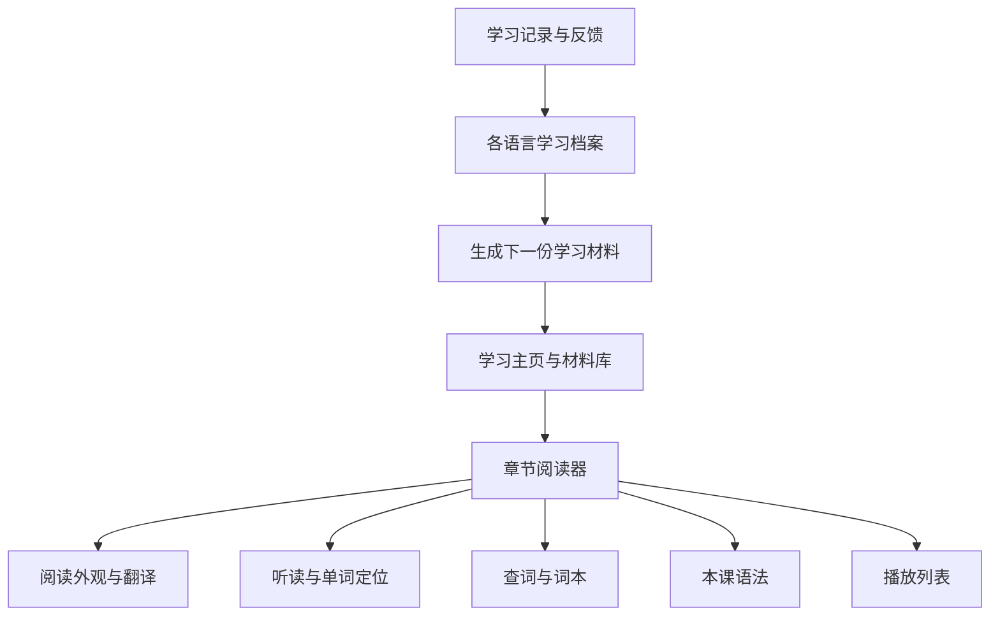

# 语言学习网页设计规范

版本：0.1 · 更新日期：2026-11-13

本文件是可独立复制到其他语言项目的产品设计基线，不记录具体项目进度。功能状态分为「已确定」「建议」「待定」；建议不代表已获确认。

## 1. 项目适配

复制到新项目后，填写以下配置：

| 配置 | 内容 |
| --- | --- |
| 项目名称 | 自定义 |
| 学习语言 | 自定义 |
| 界面语言 | 中文为当前设计基线，可调整 |
| 翻译语言 | 可选，语言范围待定 |
| 正文方向 | 按语言设置 LTR 或 RTL |
| 字体及特殊符号 | 按语言适配 |

本规范不绑定某个学习语言；具体项目配置及交付方案记录在项目专属设计中。通用功能不得依赖某一种语言的特定书写方向。

## 2. 视觉风格与参考

当前界面基线为用户于 2026-11-13 提供并确认的四张网页截图，替代最初的参考图。使用暖白背景、浅绿色卡片、深绿色主要按钮、圆角容器和简洁线条图标。

首页、词汇、播放列表、我的为主要导航。首页突出继续阅读与材料导入；词本采用书架式封面卡片；播放列表采用分组卡片；我的页面提供材料导入和学习数据备份恢复入口。阅读器继续遵循下文五图标工具栏要求。

截图中的书名、数量、列表名和学习记录为示例状态，不是固定内容。截图不替代尚未拍摄的阅读器或其他功能需求。

### 首页

### 词汇与我的词本

### 播放列表

### 我的

## 3. 页面结构

### 3.1 首页与阅读材料库

设计基线：顶部继续阅读卡片，下方展示阅读材料；底部为主要导航。

建议支持搜索、排序、书籍／片段筛选、语言筛选、导入入口，以及材料列表／方块视图切换。具体导入格式与范围待定。

### 3.2 词汇与我的词本

设计基线：词汇页包含最近接触、我的收藏、我的词本。

已确定：我的词本入口采用阅读软件书架式浏览，可切换方块视图和条目视图；进入词本后，单词支持完整条目查看与卡片浏览。

建议：词本方块展示封面、名称、词数；条目展示名称、词数及最近学习时间。视图选择可记忆。

待定：单词卡片正反面、翻转方式、顺序、掌握状态和复习规则。暂不认定需要 FSRS 或其他算法。

### 3.3 播放列表

设计基线：展示已有播放列表、新建入口及当前播放队列入口。

已确定：阅读器可选择目标播放列表并添加内容。

待定：添加对象为整本书、当前章节或可选范围；排序、删除与重复添加规则。

### 3.4 我的

建议放置学习偏好、数据管理和统计；具体范围待定。

## 4. 书籍与章节

已确定：书籍和生词本内容由 AI 生成；书籍支持分章节阅读与收听。

建议提供章节目录，保存阅读和播放位置。音频生成方式、音色、音质与生成工具尚未确定。

## 5. 阅读器交互

以下行为为初始默认设置，用户可以通过设置调整。具体可配置选项后续细化。

| 操作 | 收听模式 | 阅读模式 |
| --- | --- | --- |
| 单击正文单词 | 从所点单词对应的章节音频位置开始播放 | 查词 |
| 长按正文单词 | 查词 | 待定 |
| 单击遮盖的翻译 | 显示对应翻译 | 显示对应翻译 |

核心要求：收听定位精确到所点单词，不能仅从该句开头播放。播放继续沿当前章节音频进行。

建议：正文与翻译点击区域分开；点击空白不触发跳转；长按完成后不再额外触发单击播放。桌面鼠标、触屏长按与文本选择的兼容细节待定。

## 6. 阅读器工具栏

已确定：默认极简，详细选项点击后展开；右上角仅保留以下五个图标，从左到右顺序固定，不能因正文 RTL 而反转。

| 顺序 | 功能 | 展开内容 |
| --- | --- | --- |
| 1 | 阅读设置 | 背景颜色、字体大小等 |
| 2 | 翻译 | 翻译语言与翻译显示模式 |
| 3 | 音频播放 | 屏幕下方的小型播放控制栏 |
| 4 | 加号 | 选择添加到哪个播放列表 |
| 5 | 三个点 | 详细设置界面 |

图标不常驻文字。建议提供悬停提示、无障碍名称及足够的触控区域。

待定：阅读／收听模式切换入口；点击音频图标是否同时切换模式或自动播放；设置面板采用弹层、抽屉还是其他形式。

## 7. 音频控制

已确定：小型播放控制栏在屏幕下方展开，左侧上一句，中间播放／暂停，右侧下一句。

正文点击以单词定位；控制栏上一句／下一句以句子定位。此处“左／右键”指界面按钮的位置，不预设为鼠标左右键或键盘快捷键。

待定：上一句是返回本句开头还是前一句；播速、循环、跨章节播放、面板收起与播放状态关系。

## 8. 翻译

已确定：可选翻译语言；支持开启、关闭、遮盖三种模式。遮盖模式单击遮盖区域显示对应翻译。

待定：按句或按段翻译与揭示；是否可再次遮盖；切换章节后是否重置揭示状态。

## 9. 阅读外观与语言适配

已确定：可调整背景颜色、字体大小。

建议：提供行距、字体选择，并按学习语言设置正文方向；中文界面与翻译按其自身方向排版。阿拉伯语预留元音符号显示设置，具体处理规则待定。

## 10. 材料管理与学习数据

用户能够添加书籍、词本及配套音频和翻译，无须因新增材料重新安装整个应用。

配套资源应正确关联；具备对齐信息的音频支持按单词定位。缺少配套内容时，明确提示可用功能。

内容更新应尽量保留已有学习记录；无法对应的位置应提示用户处理。支持学习数据备份和恢复，便于更换设备或恢复数据。

具体材料格式、打包方式、传输方式、存储技术和更新规则由各项目单独设计，不属于本通用使用需求。

## 11. 核心验收场景

1. 打开一本多章节书籍，可分别进入章节阅读与收听。
2. 收听模式点击句子中间的单词，从该词对应的音频位置播放；长按该词打开查词。
3. 阅读模式点击单词打开查词。
4. 翻译可切换显示、关闭及遮盖；遮盖区域点击后显示对应内容。
5. 顶部五个图标顺序正确，详细选项仅在展开后显示。
6. 音频面板可上一句、暂停／继续、下一句。
7. 加号允许选择目标播放列表。
8. 词本书架支持方块／条目视图，词条支持完整展示／卡片浏览。

## 12. 维护方式

新决定更新对应章节；未确认内容保留“建议”或“待定”标记。项目任务、进度及讨论记录另存，不混入本规范。新增图片放在 assets/design 下，通过相对路径引用；复制本规范到新项目时同时复制该图片目录。

## 13. 阅读器与语法界面基线

以下为用户提供的当前阅读器功能截图，与第 2 节四张页面图共同构成视觉基线。正文例句与学习状态为示例。

默认保持正文简洁，顶部为返回及五个图标；翻译按当前模式显示、隐藏或遮盖，遮盖区域点击揭示。章节末尾提供上一章／下一章。

更多设置包含阅读／收听模式、播放速度、查看本课语法和章节目录。语法查看展示新学／复习标记、讲解及引用本课正文的例句；没有语法内容时显示空状态。截图确认入口存在，不代表图中示例材料已经包含语法或配套音频。

## 14. 通用功能结构

这是整体使用流程。档案交换与自动记录属于逐步实现范围，不能据此认定当前网页已完整支持闭环。

## 2026-11-13 卡片与学习模块需求

所有单词界面（词本词条、最近接触、我的收藏、查词详情、我的学习）提供条目／卡片入口，共享卡片设置。书架的方块／列表切换与单词卡片切换仍各自独立。

通用设置支持：单词释义默认显示／点击揭示；例句显示开关；例句翻译直接显示／点击揭示／关闭；拉丁字母转写开关。没有配套字段时提示缺失，不自动编造。

卡片支持左右滑动、键盘方向键和自动连续播放。移除上一张／下一张按钮，改为陌生／模糊／熟悉。浏览或播放不自动改变记忆状态。新增“我的学习”，按到期、新词或标签筛选并安排复习。

更多设置新增定时停止播放，15／30／45／60 分钟或自定义。停止同时适用于章节与卡片；手机后台计时精度受浏览器限制。

## 完整材料内容要求（最新）

后续生成的阅读材料应提供书籍、配套词本、各自的真实音频、词汇拉丁字母转写注音、中文翻译、例句及例句翻译和章节语法。章节音频支持真实单词级定位。封面保持可选，默认不生成。

“英语转写”指使用拉丁字母表达发音，不是英语释义；按材料说明采用一致体系。基础查询词典可不带音频，学习材料默认需要配音。旧材料兼容性不降低新材料完整交付要求。

## 单词点击发音与个性化（新增）

条目模式也显示词汇拉丁字母转写。条目和卡片中的单词区域均可单击发音，与点击卡片其他区域揭示翻译分开。

手动发音优先于连续播放：立即中断当前词，朗读所点词；原来处于连续模式时，从该词后续位置继续；原来未播放时只读该词，不自动开始一整轮。条目模式也提供连续播放入口。

个人空间支持页面主题背景色、页面图标色、自定义展板文字和背景图片。桌面 App 图标采用预置配色切换；网页选择与原生桌面生效状态应明确区分。无关开发说明移到使用文档，界面保留必要功能状态与来源说明。
