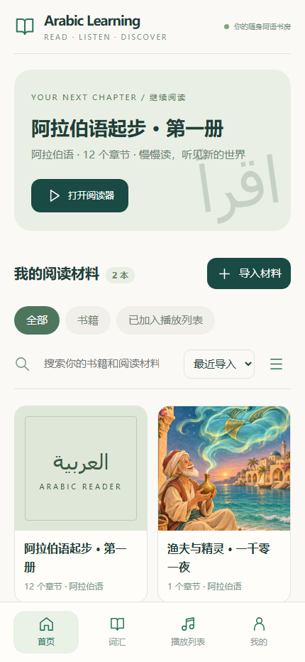
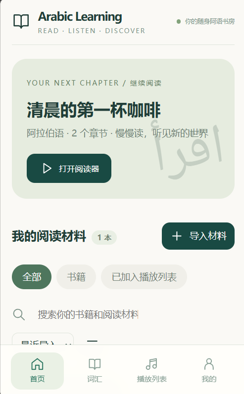
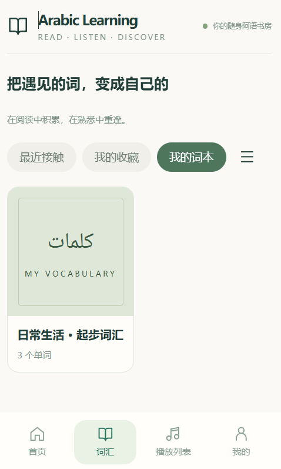
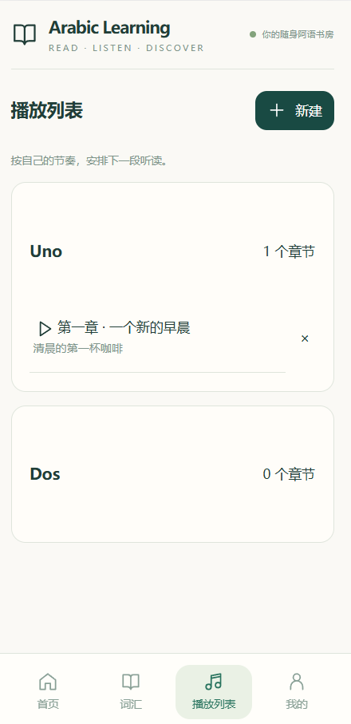
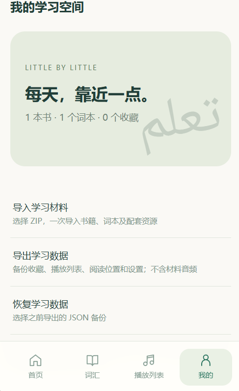
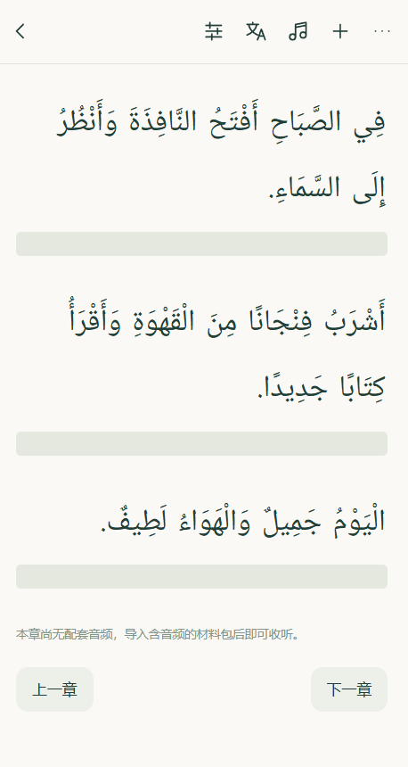
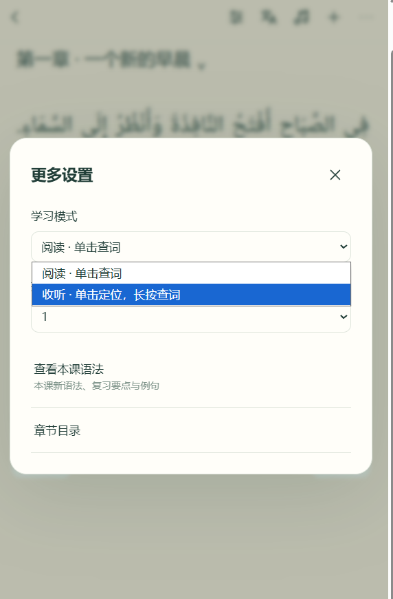
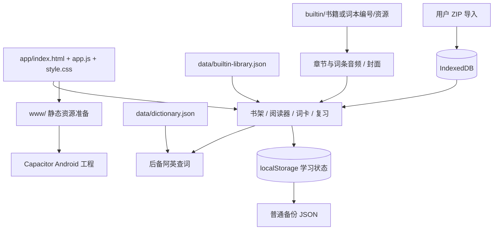

# Arabic Learning 项目具体设计

更新：2026-11-13 · 当前实现版本 0.2.0

## 文档分工

语言学习网页设计规范.md 维护可复用的用户需求；本文件维护当前实现与工程约束；项目进度与讨论.md 记录时间线；材料包格式.md 是数据协议；material-delivery.config.json 是新材料交付检查清单；使用说明.md 面向使用者。

## 页面与交互基线

暖白背景、浅绿色卡片、深绿色按钮、线条图标。首页、词汇、播放列表、我的作为主要导航。词汇含最近接触、收藏、词本、我的学习。

先前四张用户截图仍作为风格及功能参考：

| 首页 | 词汇 |
| --- | --- |
|  |  |
|  |  |

阅读器保持右上五图标，更多设置提供模式、播速、定时停止、本课语法和章节目录。翻译按句显示／关闭／遮盖；音频面板不自动切换学习模式。加入列表的对象为当前章节。

截图内示例数据不代表固定内容；当前内置书籍已替代初始演示文本。

## 软件结构

- app.js：单页渲染、交互、查词、播放、词卡、复习及导入；无业务后端。
- scripts/serve.mjs：开发静态服务，4173 端口。
- data/builtin-library.json：内置教材/故事/词本清单。
- builtin/：书籍和词本分别按 id 保存封面、章节和词条音频。
- data/dictionary.json：延迟加载的阿英词典与词形索引；不作为普通词本进入复习。
- scripts/package-mobile.py：生成含全部运行资源的网页 ZIP。
- scripts/prepare-android.mjs：复制经过筛选的资源到 www/，移除在线字体依赖，不编译 APK。
- capacitor.config.json、android/：Android 封装配置与原生工程。

## 数据读取与内置更新

启动合并内置书籍与用户库，按稳定 id 和版本更新，保留用户导入材料与学习状态。历史 demo-arabic/demo-notes 不再作为默认内容。内置资源只读，不在首次启动时重复复制进 IndexedDB。

资源查询先查 IndexedDB，未找到且属于内置资源白名单时读取 builtin/。书籍、封面以 book.id 命名；词条音频以 notebook.id 命名。导入更新资源可以覆盖同名内置项，学习状态仍独立保存。

用户材料及 Blob 保存在 IndexedDB content/assets；设置、进度、收藏、播放列表、卡片设置和复习状态在 localStorage。普通备份不含音频资源；手机专用学习进度导出仍未实现。

## 查词

优先当前书籍关联词本，再其他词本，再内置词典。忽略元音符号、装饰延长线和外围标点，查询词形映射；只有词库确有条目时才返回去前缀候选并提示不确定性，不将机械去前缀视为语法分析。

内置来源是 Kaikki 提供的英语 Wiktionary 阿拉伯语快照，处理后有 26,775 个规范化检索键、293,711 个词形索引。词义以英文显示并注明来源，提供原词条链接。保留 CC BY-SA 4.0 归属和修改说明，不打包词典媒体。

## 阅读与音频

收听单击定位到词，长按查词；阅读单击查词。章节连续 MP3 使用实际 WordBoundary 元数据，与正文按去标点及元音符号规则逐词核对。独立词条 MP3 单独生成。语音为 ar-SA-HamedNeural，章节速率 -15%，词条 -10%。

上一句定位当前时间之前最近句首，下一句定位之后句首；章节结束不自动跨章。播放异步返回时校验当前阅读器上下文，避免用户离开后重绘失效页面。

定时停止按墙钟截止时间检查，选项 15/30/45/60 分钟和自定义 1–1440 分钟；到期暂停章节与词卡，不跨刷新保存，后台冻结可延迟。

## 统一词卡与复习

所有词条来源共用卡片／列表及设置。词本新增按课筛选；查词弹层可打开单卡。设置支持释义显示、例句及翻译、拉丁字母转写与播放停留时长。

左右滑动和方向键切词；揭示只原位更新文字。连续播放按词音频结束与停留时间推进；无音频旧条目按时展示，缺音频明确提示。切换页面、手动切词、评分停止自动播放。

复习键为 language + lemma/word。陌生 10 分钟、模糊 1 天、首次熟悉 3 天、连续熟悉乘 2.5，最多 180 天。评分历史和到期时间独立于材料；不是 FSRS，不由自动播放推断掌握。

## 材料生成与交付

学习室下的 language-materials skill 读取分语言档案；教材默认 12 课，每课 10–25 新词，主题阅读按要求长度。完整交付需书籍、词本、章节与词条音频、真实对齐、转写、翻译、例句和语法。封面仅指定时生成。

check_complete.py 检查结构与资源，pack.py 打包 ZIP；词汇覆盖、教学合理性、发音和时间边界仍需质量检查。当前两份正式材料均已完成配音和结构验证。

## Android 准备与尚未完成项

Capacitor 8.6.2；appId com.stusta.arabiclearning；webDir www；无开发服务器 URL。原生工程 minSdk 24、compile/target 36，Java 21。已创建并同步，未编译/签名 APK；应用版本 0.2.0。

仍需：JDK/SDK 环境、原生文件导入导出适配确认、真机离线/后台/音频焦点测试、图标及启动页确认、签名配置。未实现云同步、手机专用进度导出、自建词本与 PWA 离线缓存。未经人工逐条审听，不声称教学内容或语音已达到出版级审定。

## 个性化与点击优先播放（本轮最新）

项目文案按用户原拼写：词汇标题 Unas Dias；词汇/播放列表副标题 Remember Me；个人展板默认 MIY FLIZ，可自行修改。首页内置资源说明与个人页存储开发提示已从界面移除，保留在使用说明。

词条列表始终展示转写。单词为独立发音按钮；卡片单词点击只发音，不切换释义。卡片其他区域仍原位揭示翻译。

手动点击取消旧播放回调与定时推进、更新当前位置并使用独立词音频。原先连续播放时保留连续状态，从所点词继续；单次朗读则不推进。列表自动推进只更新当前行和播放图标，不重建列表，避免滚动跳动。异步读资源和播放失败按 generation 标识丢弃过期回调。

state.personalization 保存页面背景、页面图标色、展板文字、桌面图标预选。展板图片单独存于 IndexedDB content 的 personalization-background，以 Blob URL 展示，不把图片塞进 localStorage；普通学习备份额外包含 personalizationBackground 数据 URL。支持 PNG/JPEG/WebP，最多 8MB，解码校验后保存。阅读器背景仍由阅读设置单独控制。

Android 新增 AppIconPlugin，通过五组 activity-alias 切换绿色、蓝色、玫瑰色、琥珀色、紫色桌面图标，先启用目标入口再停用其他入口。前端使用本地 Capacitor core 运行时调用。浏览器只能保存和预览配色，不会改变系统桌面图标。原生资源/清单通过结构检查，尚未编译或真机验证。

浏览器已验证条目转写、静止时单词发音、手动发音打断并恢复连续播放、卡片发音不翻译翻转、个性化文字/图标色以及图片上传保存。
